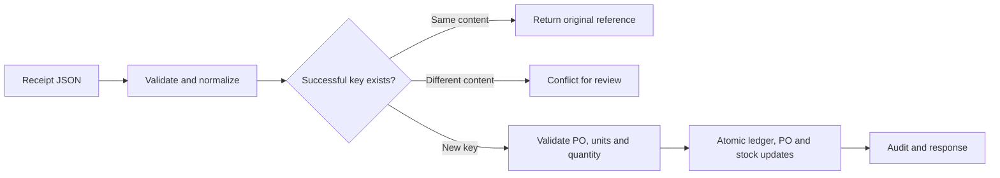

# Purchase Order & Goods Receipt Interface

**An independent Business Analyst case study with fictional demonstration data, proposed integration specifications, and an executable local reference implementation.**

This project translates a purchasing/receiving need into business requirements, system rules, process diagrams, an interface contract, database design and acceptance tests. It demonstrates how a BA connects business users, developers, QA and support through a traceable specification.

## Business problem

A warehouse system needs to send goods-receipt transactions to a purchasing system. A valid receipt should update the correct PO line and inventory once. Lost responses and retries must not create extra stock; partial receipts and corrections must remain traceable; invalid submissions need clear errors and owners.

The proposed interface supports one registered source and one warehouse. It demonstrates a controlled baseline rather than claiming a production ERP integration or completed client engagement. No stakeholder interviews, business approvals, UAT sign-offs or realized savings are represented as having occurred.

## Start here

- **Business reviewer:** [business requirements](docs/01_BUSINESS_REQUIREMENTS.md), [process diagrams](docs/02_PROCESSES_AND_ARCHITECTURE.md), and [user guide](docs/08_USER_AND_SUPPORT_GUIDE.md).
- **Developer/architect:** [interface specification and field mapping](docs/03_INTERFACE_SPECIFICATION.md), [SQL Server implementation](sqlserver/README.md), and [reference processor](src/interface.py).
- **QA reviewer:** [requirements traceability](docs/04_REQUIREMENTS_AND_TRACEABILITY.md), [test plan/UAT pack](docs/05_TEST_PLAN_AND_UAT.md), and [executed results](reports/test_results.txt).
- **Hiring manager:** the business problem above, evidence status below, and the [change request](docs/06_CHANGE_REQUEST_CR001.md) show the project's BA scope.

## Evidence status

| Deliverable | Status |
|---|---|
| BRD, requirements, stories, mappings and process diagrams | Authored as proposed case-study baseline |
| Local JSON processing via Python/SQLite | Implemented and executed |
| Functional, rollback and local concurrency regression tests | **28 tests passed**; zero failures/errors |
| Receipt/reversal ledger and balance reconciliation | Executed and passed in local reference |
| SQL Server schema, core procedure, tracing and smoke tests | Supplied; **NOT EXECUTED on SQL Server** |
| Live HTTP endpoint, identity binding and ERP/WMS integration | Proposed design only |
| Production performance, security, recovery and monitoring | Not implemented or measured |
| Business UAT, requirement approval and release sign-off | Prepared; not performed |
| CR001 multi-warehouse expansion | Proposed, unapproved and unimplemented |

The distinction between reference evidence and release readiness is deliberate. SQLite test results do not prove SQL Server parity, real business acceptance or production benefits. See [validation.json](reports/validation.json).

## Requirements translated into behavior

| Business need | System behavior | Evidence |
|---|---|---|
| Retry after an uncertain response without extra stock | Successful source/receipt key plus normalized payload hash; same content returns original reference | FR04; TC02/03/24/25 |
| Receive an order in several deliveries | Distinct positive receipt IDs accumulate up to ordered quantity | FR03; TC01/09/10/26 |
| Correct a successful receipt safely | New full-reversal event tied to original receipt; no edits or double reversal | FR05; TC16–21 |
| Avoid partial updates after failures | Ledger, PO and stock updates in one transaction; rollback and safe retry | FR06; TC22/23 |
| Explain and trace exceptions | Stable codes, attempt audit and source-to-target queries | FR07/08/11; test and demonstration reports |

Example acceptance criterion:

> Given a 25-unit receipt has already posted, when the sender resubmits the same source/receipt ID with equivalent normalized content, then the system returns DUPLICATE with the original processing reference and does not add another ledger movement or increase stock again.

The complete requirements matrix links 11 functional requirements and four proposed nonfunctional requirements to design, tests and remaining gates. [View traceability](docs/04_REQUIREMENTS_AND_TRACEABILITY.md).

## Proposed flow



Detailed current-state, future-state, system-context, lost-response and relational diagrams are in [processes and architecture](docs/02_PROCESSES_AND_ARCHITECTURE.md). The current-state workflow is an elicitation hypothesis, not an observed company process.

## Run the reference demonstration

**Python 3.12+; no third-party packages required.** From the extracted project's root folder:

```bash
python run_demo.py
```

On Windows, `py -3.12 run_demo.py` is an alternative if that Python launcher is installed. The demo uses a fixed clock of **2026-10-18T12:00:00Z**. It runs 28 tests in isolated temporary databases, executes a fresh example sequence and regenerates the reports. It does not reset the persistent CLI practice database.

The tests cover contract errors, partial receipts, duplicate/conflicting submissions, exact decimal quantities, invalid dates, reversals, negative balance prevention, fault-injected rollback and competing concurrent receipts. Inspect [test_results.txt](reports/test_results.txt) for actual execution output.

### Execute individual payloads

```bash
python src/cli.py examples/valid_receipt.json
python src/cli.py examples/valid_receipt.json
python src/cli.py examples/full_reversal.json
```

On a fresh CLI database, these return POSTED, DUPLICATE and POSTED. Default state persists in ignored `runtime/demo.db`; later runs may return duplicates. Use `--db runtime/practice2.db` for a new independent practice database. Nothing is transmitted externally, and no HTTP endpoint is running.

### Demonstrated result

| Step | Outcome | Business effect |
|---|---|---|
| Receive 25 units against a 100-unit PO line | POSTED / 201 | Ledger +25; PO received +25; stock +25 |
| Retry the identical receipt | DUPLICATE / 200 | No additional business movement |
| Reuse its successful key with quantity 30 | IDEMPOTENCY_CONFLICT / 409 | Existing posting preserved |
| Full reversal with a new ID referencing original | POSTED / 201 | Ledger −25; PO and stock return to zero |
| Retry the reversal | DUPLICATE / 200 | No second reversal |

The fresh example has five audited attempts and two ledger movements, with net PO/stock movement zero. [Inspect complete evidence](reports/demo_evidence.json).

## Design choices worth discussing

- **Idempotency is a business rule.** A database unique key stops a second insert but does not distinguish an identical retry from conflicting business content. The payload comparison does.
- **Successful keys remain reserved.** A reversed receipt still owns its ID. A request rejected before posting can be corrected and resubmitted with the same ID.
- **Receipts and reversals are ledger events.** Corrections preserve history instead of overwriting accepted data. Version 1 supports full reversals only.
- **Precision is explicit.** JSON quantities are decimal strings. SQLite stores integer thousandths; SQL Server uses decimal(18,3). Excess precision is rejected rather than silently rounded.
- **Atomicity covers the business transaction.** A test failure after ledger insertion leaves no partial PO/stock update. Audit-store outages still need production observability and reconciliation design.
- **One warehouse is a scope decision.** MAIN is supported; another warehouse is rejected. CR001 documents the impact of expanding this baseline rather than silently implementing it.
- **Business time is not a delivery-performance metric.** These records demonstrate interface behavior; they do not prove supplier lateness, stockout reduction or financial ROI.

## SQL Server deliverables

The [SQL Server folder](sqlserver/README.md) contains:

1. Schema and fictional seed records.
2. An internal normalized-parameter posting procedure with transaction and duplicate/reversal checks.
3. Source-to-target tracing and reconciliation queries.
4. Smoke assertions for receipt, retry, conflict, rollback, reversal and canonical hash parity.

**Execution limitation:** no SQL Server instance was available, so these scripts are not marked passed. The core requires a strict validating/authenticated adapter; it is not a public JSON endpoint. Use a new empty demo database and follow the folder README. The scripts use SQL Server 2016 SP1+ features and are not compatible with SQL Server 2000/2005/2008 as written. Legacy compatibility, actual deployment and engine-specific tests remain separate tasks.

## BA deliverables

| Artifact | What it demonstrates |
|---|---|
| [Business requirements document](docs/01_BUSINESS_REQUIREMENTS.md) | Business objectives, scope, users, rules, assumptions and approval gates |
| [Process/architecture diagrams](docs/02_PROCESSES_AND_ARCHITECTURE.md) | Current/future process thinking and technical/nontechnical communication |
| [Interface specification](docs/03_INTERFACE_SPECIFICATION.md) | Field mappings, validation, contract, errors, normalization and source-to-target design |
| [Requirements, stories and traceability](docs/04_REQUIREMENTS_AND_TRACEABILITY.md) | Concise testable specifications linked to implementation and tests |
| [Test plan and UAT pack](docs/05_TEST_PLAN_AND_UAT.md) | Functional, integration, recovery and acceptance planning with honest execution status |
| [Change request CR001](docs/06_CHANGE_REQUEST_CR001.md) | Options, dependency/impact assessment, recommendation and pending decision |
| [Delivery/stakeholder pack](docs/07_DELIVERY_AND_STAKEHOLDER_PACK.md) | Proposed SDLC plan, RACI, issue register, agenda, status report and training outline |
| [User/support guide](docs/08_USER_AND_SUPPORT_GUIDE.md) | Practical receipt/correction instructions, triage and knowledge checks |

## Repository structure

```text
docs/                  # Eight BA documents, diagrams and traceability
examples/              # Valid receipt and full reversal JSON
src/
  interface.py         # Executed Python/SQLite reference
  cli.py               # Local request/response demonstration
sqlserver/             # Target core implementation and execution instructions
tests/                 # 28 automated reference tests
reports/               # Test log, validation status and demo evidence
run_demo.py
requirements.txt       # Standard-library-only runtime note
README.md
```

## Next implementation and business gates

Validate the assumptions with actual process owners; review and approve the requirement baseline; implement authenticated transport and source authorization; execute SQL Server functional/parity/concurrency/recovery tests; set and measure load targets; complete business UAT and training; then obtain a documented release decision. Production benefits require before/after measurement against an agreed baseline.

This case study is designed to support discussion of requirements definition, interface analysis, SQL/database tracing, SDLC, test planning and stakeholder communication. Proposed meetings, assignments and schedules are examples, not claims of actual client delivery.
