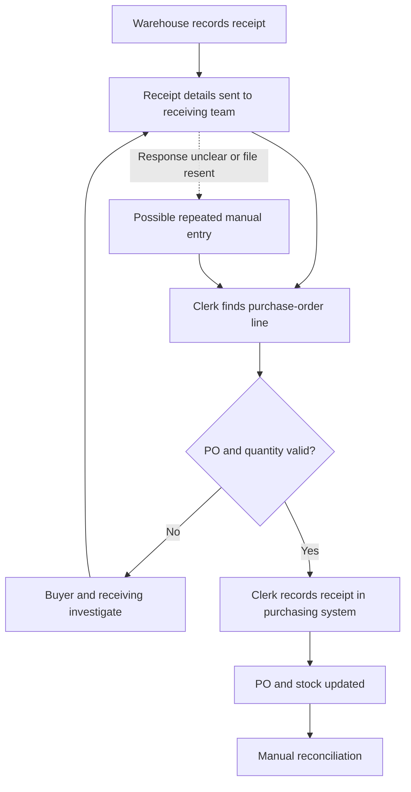
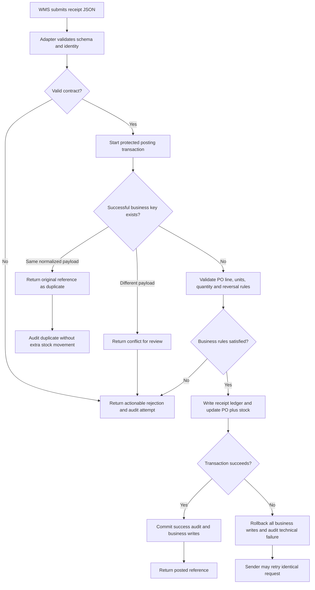
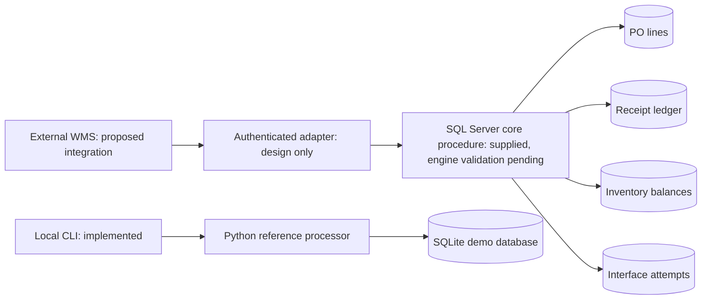
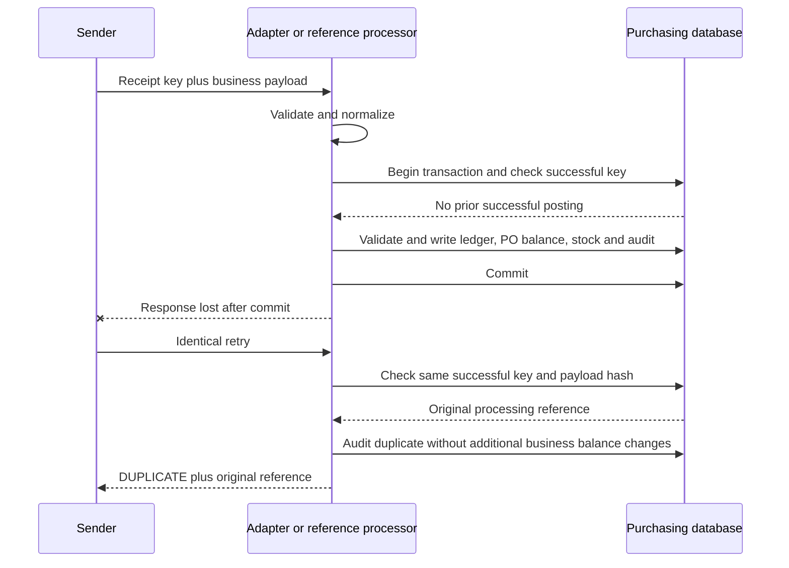
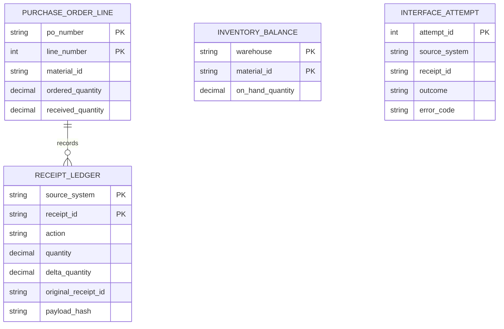

# Processes and system boundaries

## Assumed current state: validate through elicitation

This diagram is an illustrative manual workflow, not an observed or measured company process.

## Proposed future state

## Proposed system context vs implemented example

The local CLI demonstrates request processing; it is not a deployed endpoint or authentication service. SQL Server scripts implement the proposed core posting model behind an adapter. Do not substitute SQLite test results for SQL Server transaction or performance evidence.

## Transaction sequence and lost-response retry

## Relational model

An attempt may be malformed or rejected, so it need not have a successful ledger parent. Reversal references are validated against the original receipt by business logic. Inventory is related by warehouse/material through the PO line. Posting is all-or-nothing across ledger and balances; failed-attempt logging occurs after rollback. If the audit store itself is unavailable, production telemetry/reconciliation must detect the failure; that recovery integration is pending.
